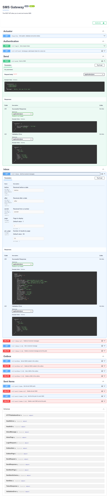

# SMS Gateway

This REST API allow you to send and receive SMS using gammu-smsd.

A swagger documentation is provided at the root URL.

All routes can be protected by an authentication methode (Basic, Bearer).

# Table of Contents

* [Requirements](#requirements)
* [Installation](#installation)
* [Run containers](#run-containers)
* [Usage](#usage)
* [Receive SMS in your application](#receive-sms-in-your-application)
* [Environment Variables](#environment-variables)
* [Production](#production)
* [Upgrading to 3.0](#upgrading-to-30)
* [My setup](#my-setup)
* [Screenshots](#screenshots)

## Requirements

Docker with Docker Compose.

A `SQL` database: MariaDB, provided by the compose file.

[A device supported by Gammu library](https://wammu.eu/phones/)

A sim card to send and received SMS.

## Installation

Create a folder into the host for persistant data (SQL data)

    $ mkdir -p /opt/mariadb

Get `docker-compose.yml` and `.env.example` from this repository, then create your configuration and replace every value

    $ cp .env.example .env

Never commit the `.env` file.

# Run containers
```
$ docker compose up -d
```

The container prepares the database, then starts gammu-smsd and the API. It refuses to start when a required secret is missing: read its logs with `docker logs sms-gateway_server`.

# Usage

The interactive documentation is at `http://<host>:5000/`, and the OpenAPI document at `/openapi.json`.

## Send a SMS

```
$ curl -X POST http://localhost:5000/v1/send \
    -H 'Content-Type: application/json' \
    -d '{"recipients": ["+12025550123"], "message": "Hello"}'

{"results": [{"DestinationNumber": "+12025550123", "smsID": "1"}]}
```

A recipient is an optional `+` followed by 3 to 20 digits, without spaces. A message has at most 480 characters. The answer means that the SMS is queued, not yet sent: it stays in `/v1/outbox` until gammu-smsd handles it, then appears in `/v1/sentitems`.

## Routes

| Route | Methods | Description |
|---|---|---|
| `/v1/send` | POST | Queue a message for each recipient |
| `/v1/inbox` | GET | Received messages. Filters: `before`, `after`, `sender` |
| `/v1/outbox` | GET | SMS waiting to be sent. Filters: `before`, `after`, `destination` |
| `/v1/sentitems` | GET | Sent SMS, one entry per part. Filters: `before`, `after`, `destination` |
| `/v1/{inbox,outbox,sentitems}/{id}` | GET, DELETE | One entry. DELETE removes all the parts of the SMS |
| `/v1/{inbox,outbox,sentitems}/all` | DELETE | Delete everything in that box |
| `/v1/login` | POST | Get a bearer token |
| `/v1/refresh` | GET | Exchange a valid bearer token for a new one |
| `/healthz` | GET | Service, database and phone status |

Lists take `page` (default 1) and `per_page` (default 50), and answer with `page`, `total_pages` and `results`. Dates look like `2026-01-31` or `2026-01-31T12:00:00`.

Errors are JSON with a `message`. Invalid input gives a 400.

## Health

`/healthz` answers 200 when the database and the phone both work:

```
{"status": "healthy", "database": "connected", "phone": "connected", "signal": 74, "network": "T-Mobile"}
```

It answers 500 otherwise, and the container becomes `unhealthy`:

```
{"status": "unhealthy", "database": "connected", "phone": "disconnected", "error": "No recent status from gammu-smsd"}
```

The state comes from the status gammu-smsd publishes every 60 seconds, so a failure can take up to 70 seconds to show. `signal` is a percentage, -1 if unknown. Docker does not restart an `unhealthy` container on its own.

## Received messages

A long SMS travels as several parts. `/v1/inbox` returns the whole message, with its text in `TextDecoded`.

* `ID` identifies the message. Use it to get or delete the message: deleting removes all its parts.
* `Complete` is `false` while parts are missing, with `PartCount` announced and `ReceivedParts` stored. The message already holds the text received so far, and a part lost by the network leaves it incomplete for good.

## Authentication

Set `API_SECURITY` to protect the `send`, `inbox`, `outbox` and `sentitems` routes. `/healthz`, `/v1/login` and the documentation always stay open.

With `Basic`, send your credentials:

```
$ curl -u "$API_USERNAME:$API_PASSWORD" http://localhost:5000/v1/inbox
```

With `Bearer`, get a token, then send it:

```
$ curl -X POST http://localhost:5000/v1/login \
    -H 'Content-Type: application/json' \
    -d '{"username": "<API_USERNAME>", "password": "<API_PASSWORD>"}'

{"access_token": "<token>"}

$ curl -H 'Authorization: Bearer <token>' http://localhost:5000/v1/inbox
```

Any `API_SECURITY` value other than exactly `None`, `Bearer` or `Basic`, such as `bearer`, refuses to start.

After 5 failed attempts in 5 minutes, `/v1/login` answers 429 for that client, with a `Retry-After` header.

# Receive SMS in your application

The gateway can send each new SMS to your application. Set in `.env`:

```
WEBHOOK_URL=https://your-app.example/sms
WEBHOOK_SECRET=<a long random value>
```

Your application exposes this route and receives a `POST` per message, with the same fields as `/v1/inbox/{id}`:

```
POST /sms
Content-Type: application/json
X-Gateway-Signature: sha256=<HMAC-SHA256 of the body, with WEBHOOK_SECRET>

{"ID": 42, "SenderNumber": "+12025550123", "TextDecoded": "Hello", "Complete": true, ...}
```

Your application must:

1. Check the signature, to refuse calls that do not come from the gateway:

   ```python
   import hashlib, hmac

   expected = "sha256=" + hmac.new(secret.encode(), raw_body, hashlib.sha256).hexdigest()
   valid = hmac.compare_digest(expected, request.headers["X-Gateway-Signature"])
   ```

2. Ignore an `ID` it has already handled: a message can be sent twice if your answer gets lost.
3. Answer quickly with a 2xx. Any other answer, including a redirect, or no answer within `WEBHOOK_TIMEOUT`, means a new attempt, with delays growing from 5 seconds to 5 minutes. Later messages wait, so the order is kept.

What is sent:

* Only messages received after the first activation: older ones are not sent. They stay available in `/v1/inbox`.
* All messages: filter them in your application.
* A long SMS is one `POST` with the whole text, once all its parts are received. If a part never arrives, nothing is sent: a warning goes to the logs after `WEBHOOK_INCOMPLETE_DELAY`, and the message stays readable in `/v1/inbox`.

The `Processed` field of `/v1/inbox` becomes `true` once a message is handled.

# Environment Variables

#### SERVER_IP
    default value   : "0.0.0.0"
    description     : Bind to a specific interface

#### SERVER_PORT
    default value   : "5000"
    description     : Define server port for backend API

#### GAMMU_SMSD_CONF
    default value   : "/etc/gammu-smsdrc"
    description     : Set path of the configuration file for gammu-smsd. This file is dynamically generated at container startup

#### GAMMU_DEVICE
    default value   : "/dev/ttyUSB0"
    description     : Path of the modem device mounted into the container
    more            : https://wammu.eu/docs/manual/config/index.html#option-Device

#### GAMMU_DEVICE_CONNECTION
    default value   : "at"
    description     : Protocol which will be used to talk to your device
    more            : https://wammu.eu/docs/manual/config/index.html#option-Connection

#### GAMMU_PIN
    default value   : "1234"
    description     : PIN for SIM card. If no pin on the SIM card leave default value
    more            : https://wammu.eu/docs/manual/smsd/config.html#option-PIN

#### GAMMU_DEBUG_LEVEL
    default value   : "0"
    description     : Log level for gammu-smsd
    more            : https://wammu.eu/docs/manual/smsd/config.html#option-DebugLevel

#### MYSQL_HOST
    default value   : "localhost"
    description     : Database server address, optionally with a port ("host:port")

#### MYSQL_USER
    default value   : "root"
    description     : User name used for connection to a database

#### MYSQL_PASSWORD
    required
    description     : Password used for connection to a database

#### MYSQL_DATABASE
    default value   : "smsd"
    description     : Name of database dedicated for gammu-smsd

#### JWT_SECRET
    required with API_SECURITY "Bearer"
    description     : The secret key needed for symmetric based signing algorithms

#### JWT_ALGORITHM
    default value   : "HS256"
    allowed values  : "HS256" | "HS384" | "HS512"
    description     : Which algorithm to sign the JWT with

#### JWT_ACCESS_TOKEN_EXPIRES
    default value   : "900"
    description     : How long (in seconds) an access token should live before it expires. Can be set to 0 to disable expiration.

#### API_SECURITY
    default value   : "None"
    allowed values  : "None" | "Bearer" | "Basic"
    description     : Select the authentication methode for the routes of the Rest API. Any other value refuses to start

#### API_USERNAME
    required with API_SECURITY "Bearer" or "Basic"
    description     : User name used for connection to the rest API

#### API_PASSWORD
    required with API_SECURITY "Bearer" or "Basic"
    description     : Password used for connection to the rest API

#### WEBHOOK_URL
    default value   : none, no webhook
    description     : Address of your application, to receive each new SMS

#### WEBHOOK_SECRET
    required with WEBHOOK_URL
    description     : Key used to sign the webhook calls

#### WEBHOOK_TIMEOUT
    default value   : "10"
    description     : How long (in seconds) to wait for your application's answer

#### WEBHOOK_INCOMPLETE_DELAY
    default value   : "600"
    description     : How long (in seconds) to wait for the missing parts of a long SMS

#### RETENTION_DAYS
    default value   : none, nothing is deleted
    description     : Delete received and sent SMS older than this number of days, once a day. The outbox and messages waiting for the webhook are kept

# Production

The API has no TLS: passwords and tokens travel in clear text. If it leaves your local network, put a reverse proxy in front of it. For example, with Caddy:

```
sms.example.com {
    reverse_proxy localhost:5000
}
```

Behind a proxy, the gateway sees a single client, so all clients share the `/v1/login` attempt limit. A proxy can also limit attempts per real client.

Run one instance per modem, with a single process.

# Upgrading to 3.0

The first start changes the database in place (Gammu schema v18, InnoDB) and has no automatic way back. **Back it up first:**

```
$ docker exec sms-gateway_db sh -c 'mariadb-dump -uroot -p"$MYSQL_ROOT_PASSWORD" smsd' > smsd-backup.sql
```

1. Create `.env` from `.env.example`. The image has no default secrets anymore. Choose new passwords: the ones of the previous compose file are public.
2. Update the image and start it. The migration is automatic and its duration grows with the size of the tables.
3. Adapt your API clients to the changes below. Plan for them to log in again.

Changes for API clients:

* `/v1/inbox` returns one entry per message instead of one per part, with the new fields `InsertIntoDB`, `PartCount`, `ReceivedParts` and `Complete`. The `ID` of a later part no longer resolves. SMS received before the upgrade stay split, one message per part.
* `/v1/outbox` has a new field `SendDays`.
* `/swagger.json` is replaced by `/openapi.json` (OpenAPI 3).
* An invalid `before` or `after`, and a `page` or `per_page` under 1, give a 400.
* `/v1/refresh` without a valid token gives a 401, instead of a 500.
* `before`, `after` and `destination` now work on `/v1/outbox` and `/v1/sentitems`.
* `/healthz` also reports the phone, and answers 500 when it is disconnected. Check your monitoring.
* A malformed recipient gives a 400. A value such as `+1 202 555 0123` must lose its spaces.
* `DELETE /v1/sentitems/{id}` removes all the parts of the SMS, not only the first one.
* An invalid `API_SECURITY`, such as `bearer`, now refuses to start, instead of disabling authentication.
* A 500 no longer contains a stack trace, it is in the container logs. `/healthz` no longer contains the database error text.

# My setup

[Raspberry Pi 4 Model B](https://www.raspberrypi.org/products/raspberry-pi-4-model-b/)

[Quectel EC25 Mini PCle 4G/LTE Module](https://sixfab.com/product/quectel-ec25-mini-pcle-4glte-module/)

[Raspberry Pi interface bridge](https://sixfab.com/product/raspberry-pi-3g-4glte-base-shield-v2/)

[LTE Antenna](https://sixfab.com/product/lte-main-diversity-dual-u-fl-antenna-100mm/)

# Screenshots


